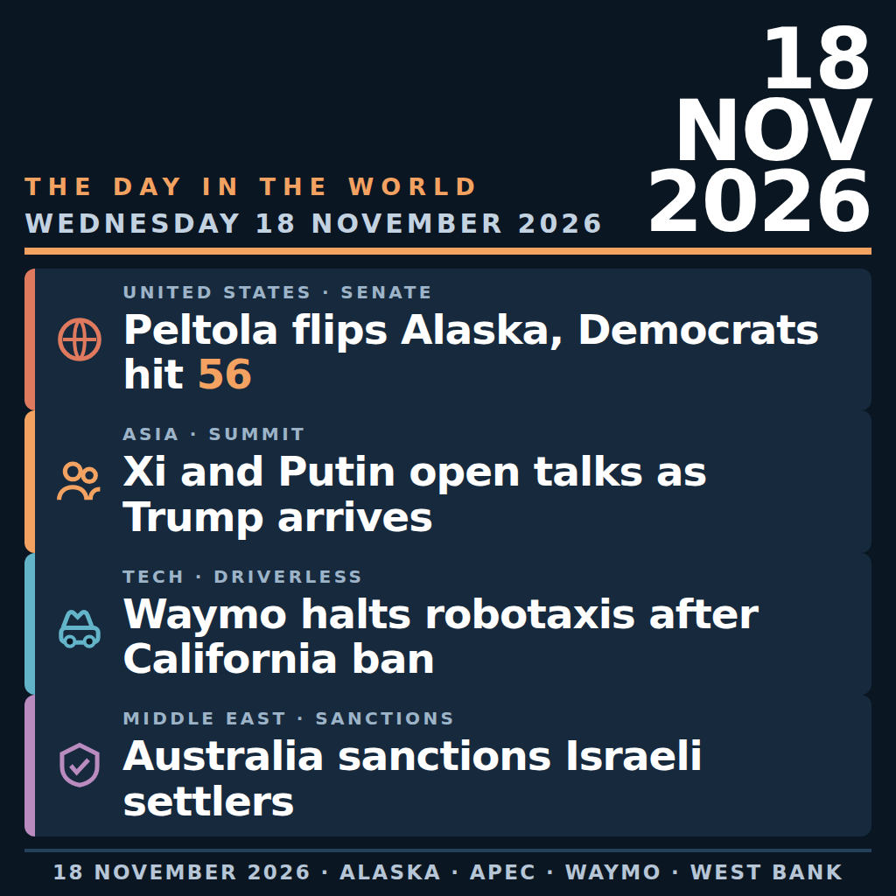

# The day in the world — 18 November 2026

One image that sums up Wednesday 18 November 2026: four stories that moved the day,
across the United States, Asia, transport technology and the Middle East, under the
date they happened.



[](https://make.fun/bounty/news-image-20261118)
[](https://make.fun/bounty/news-image-20261118)
[](https://make.fun/bounty/news-image-20261118)

## What it is

`card.html` lays out the day's four chosen stories with the date in three places, and
`render.py` draws it in a headless Chromium at a fixed 1024x1024 viewport. The render is
the browser's own layout of real type and vector icons: no borrowed photographs, no
compositing, no network request.

`entry.png` is that render, and `main.ts` copies it to `/output/entry.png`. Both grader
runs write the same bytes.

## The four stories

- **United States** — Mary Peltola flips Alaska's Senate seat, taking the Democratic caucus to 56.
- **Asia** — Xi Jinping and Vladimir Putin open talks at the APEC summit as Donald Trump arrives.
- **Technology** — Waymo suspends driverless freeway rides across the US after a California ban.
- **Middle East** — Australia sanctions Israeli settlers over West Bank violence.

## Design notes

The layout survives the judge's legibility test: shrunk to 300 pixels wide, the date and
the gist of all four headlines still read. That is why four stories get full-width rows
instead of six cramped cards — a viewer who missed the day can follow it at a glance.

## Build

```bash
mkdir -p out && MAKEFUN_OUTPUT_DIR=out node main.ts
```

Pillow and Playwright place `render.py` outside the grader: it is the tool that made
`entry.png`, and `main.ts` needs neither.

## License

MIT. See `LICENSE`.
